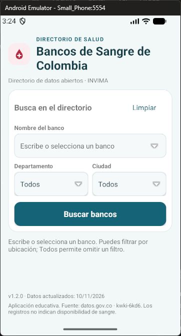
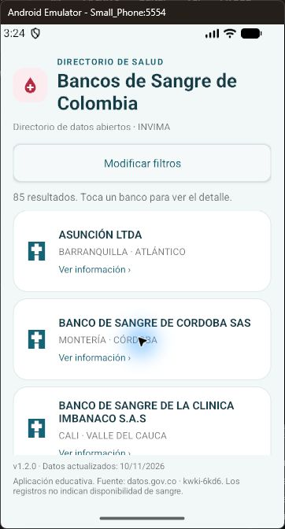
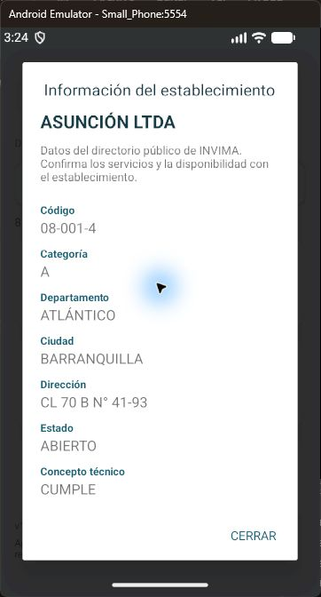

# Bancos de Sangre de Colombia · Reto 10

Aplicación educativa Android en **Java y XML** que consulta el conjunto público de bancos de sangre de Colombia y permite buscar establecimientos por nombre, departamento y ciudad.

**Versión:** 1.2.0 · **Estado de validación:** 12 de noviembre de 2026.

Desarrollada en el contexto académico de una maestría de la Universidad Nacional de Colombia indicado por el solicitante. No representa una aplicación oficial de la Universidad ni de INVIMA.

## Diseño médico · versión 1.2.0

Diseño aprobado por el solicitante antes de instalar la nueva versión. La interfaz utiliza azul clínico, fondo claro, un símbolo de sangre y tarjetas con iconos de establecimientos de salud. Se mantienen Java, XML y componentes del SDK Android.

- Formulario agrupado con nombre editable y sugerencias, ubicación en dos columnas y acción Limpiar.
- Los campos de ubicación muestran **Todos** para omitir el filtro; los diálogos conservan las etiquetas completas y la selección actual.
- Al obtener resultados, el formulario se contrae para dar espacio a las tarjetas. **Modificar filtros** permite abrirlo; **Ocultar filtros** vuelve al listado amplio.
- Tarjetas con nombre, ciudad, departamento y acceso al detalle. La ficha separa las etiquetas de sus valores y permite seleccionar el texto.
- Versión de la app y fecha de actualización de la fuente visibles al pie. La fecha sigue procediendo de `rowsUpdatedAt`.

| Inicio | Resultados | Detalle |
| --- | --- | --- |
|  |  |  |

## Funcionalidades

- Nombre del banco con escritura parcial y selección de sugerencias del catálogo.
- Departamento y ciudad mediante botones selectores con listas de opciones.
- Ciudades y sugerencias de bancos vinculadas a la ubicación elegida.
- Opción Todos para omitir un filtro de ubicación; nombre vacío para consultar todos los bancos.
- Botón **Limpiar** para restablecer campos y retirar resultados anteriores.
- Consulta al servidor mediante **Buscar bancos** o la acción **Listo** del teclado.
- Listado de resultados y detalle de cada establecimiento.
- Fecha de actualización de la fuente obtenida de sus metadatos.
- Mensajes de carga, ausencia de resultados, error de conexión y rechazo del servicio.

Al cambiar de departamento se restablecen ciudad y nombre; al cambiar de ciudad se restablece el nombre. Así se evita conservar selecciones anteriores incompatibles con la ubicación.

## Cumplimiento del reto académico

| Requisito del enunciado | Implementación |
| --- | --- |
| Consumir un servicio del catálogo colombiano | Conjunto `kwki-6kd6` de datos.gov.co |
| Enviar parámetros desde una interfaz gráfica | Filtros de nombre, departamento y ciudad enviados mediante SoQL |
| Presentar la respuesta del servicio | Listado y diálogo de detalle |
| Procesar JSON con objetos del SDK Android | `JSONObject` y `JSONArray`, sin bibliotecas externas de serialización |

El conjunto de puntos posconsumo descrito en el enunciado es un ejemplo. Este proyecto utiliza los bancos de sangre seleccionados para el ejercicio.

## Requisitos técnicos

| Componente | Configuración |
| --- | --- |
| Lenguaje e interfaz | Java y vistas XML |
| Android mínimo | Android 8.0, API 26 |
| SDK de compilación y destino | API 36 |
| Android Gradle Plugin | 9.1.0 |
| Gradle | 9.5.0, incluido mediante wrapper |
| Compatibilidad del código Java | Java 17 |
| Entorno JDK utilizado en la validación | JBR 25 incluido en Android Studio |
| Permiso requerido | Internet |

Se necesita Android Studio, el SDK correspondiente y conexión a Internet. La primera sincronización de Gradle puede requerir descargar dependencias.

## Abrir y ejecutar

1. Clonar o descargar este repositorio y abrir su carpeta raíz en Android Studio.
2. Configurar el SDK local. Android Studio puede generar `local.properties`; también se puede usar `local.properties.example` como referencia.
3. Elegir el modo de acceso a la API según la sección siguiente.
4. Sincronizar Gradle y seleccionar el módulo **app**.
5. Iniciar un emulador o conectar un dispositivo con API 26 o superior y ejecutar **Run**.

Para compilar desde PowerShell, ubicado en la raíz del proyecto:

```powershell
.\gradlew.bat assembleDebug
```

El APK debug queda en `app/build/outputs/apk/debug/app-debug.apk`. Los archivos generados de compilación no se versionan.

## Configuración del token y modos de acceso

El código selecciona el modo al compilar, según `socrata.app.token` en el archivo **local.properties de la carpeta que se está abriendo en Android Studio**.

| Configuración | Modo utilizado |
| --- | --- |
| Token válido configurado | SODA3: POST al endpoint solicitado, con cabecera `X-App-Token` |
| Propiedad ausente o vacía | SODA2: GET público sobre el mismo conjunto de datos |
| Token configurado pero rechazado | Se informa el error HTTP; no se cambia silenciosamente a SODA2 |

### Habilitar SODA3

1. Iniciar sesión en el portal Socrata y abrir **Developer Settings → Create New App Token**. Consultar la [guía oficial de tokens](https://support.socrata.com/hc/en-us/articles/210138558-Generating-App-Tokens-and-API-Keys).
2. Conservar la configuración `sdk.dir` existente en `local.properties`.
3. Agregar la propiedad `socrata.app.token` y colocar después de `=` únicamente el valor del App Token generado: sin comillas, etiquetas ni texto de ejemplo añadido.
4. Guardar, sincronizar Gradle y volver a compilar y ejecutar la app.

Para usar SODA2, la propiedad debe quedar vacía:

```properties
socrata.app.token=
```

No se requiere configurar contraseña ni API Secret. `local.properties` está excluido de Git. El token se incorpora al APK mediante BuildConfig, de modo que no debe considerarse un secreto irrecuperable dentro de una aplicación distribuida. No se publican el token ni el APK que lo incorpora.

**SODA3 fue validado el 12/11/2026:** respuesta directa HTTP 200 y conjunto completo de pruebas correcto. El repositorio incluye [la salida de validación sin credenciales](docs/pruebas/resultado-soda3.txt); cada persona debe configurar su propio token local.

## Origen de los datos y consultas

La app consume directamente la API de datos.gov.co. No extrae información de la página visual ni presenta registros simulados como datos reales.

- [Catálogo del conjunto](https://www.datos.gov.co/Salud-y-Protecci-n-Social/BANCOS-DE-SANGRE-EN-FUNCIONAMIENTO-EN-EL-PA-S/kwki-6kd6/about_data).
- [Endpoint SODA3](https://www.datos.gov.co/api/v3/views/kwki-6kd6/query.json).
- [Endpoint público SODA2](https://www.datos.gov.co/resource/kwki-6kd6.json).
- [Metadatos del conjunto](https://www.datos.gov.co/api/views/kwki-6kd6.json).
- [Documentación del conjunto](https://dev.socrata.com/foundry/www.datos.gov.co/kwki-6kd6).
- [Documentación de consultas SODA3](https://dev.socrata.com/docs/queries/).

Al iniciar se consultan las opciones del catálogo y sus metadatos. Al pulsar Buscar bancos se hace una nueva petición al servicio con los filtros elegidos.

El nombre usa coincidencia parcial sin distinguir mayúsculas. Departamento y ciudad usan igualdad sin distinguir mayúsculas. Se escapan los apóstrofes de los valores enviados. Los campos y el orden de consulta están definidos en el código.

Ejemplo del cuerpo JSON de una consulta SODA3; el token se envía en la cabecera y no en este cuerpo:

```json
{
  "query": "SELECT * WHERE upper(departamento) = upper('ANTIOQUIA') ORDER BY bancodesangre, numero_de_consecutivo",
  "page": { "pageNumber": 1, "pageSize": 1000 },
  "includeSynthetic": false
}
```

En SODA2 se codifica la consulta mediante `URLEncoder`, se envía en `$query` y se agrega `LIMIT 1000`.

## Versión de la app y fecha de los datos

La versión **1.2.0** identifica el código de la app (`versionCode=5`). La fecha mostrada junto a ella identifica la actualización de los registros de la fuente: se obtiene del campo `rowsUpdatedAt`, expresado en segundos Unix, y se presenta en la zona **America/Bogota**.

Durante las verificaciones la fuente reportó **10/11/2026**. Esa fecha se consulta al iniciar y puede cambiar con las actualizaciones del conjunto. No corresponde a la instalación ni a la compilación de la app. Si los metadatos no están disponibles, se muestra fecha no disponible y la búsqueda sigue habilitada.

## Organización del código

| Archivo o carpeta | Responsabilidad |
| --- | --- |
| `MainActivity.java` | Interfaz, coordinación de consultas, filtros dependientes y detalle |
| `BloodBankService.java` | Construcción de SoQL, HTTP, modos SODA3/SODA2, JSON y metadatos |
| `LocationPicker.java` | Botón selector estándar que abre una lista con selección actual y Cancelar |
| `app/src/main/res/layout/` | Vistas XML del formulario y las sugerencias |
| `EducationalTestRunner.java` | Pruebas instrumentadas sobre Android |
| `docs/pruebas/` | Matriz, procedimiento y resultados de ejecución |
| `docs/evidencias/` | Capturas de las versiones verificadas |

Las operaciones de red se ejecutan en un `ExecutorService`, fuera del hilo principal. La actividad actualiza la interfaz en el hilo principal. El procesamiento utiliza los objetos JSON proporcionados por Android.

## Pruebas y evidencias

**Validación de 1.2.0, 12/11/2026:** compilación e instalación correctas; regresión instrumentada por SODA3 con token local: PASS. Incluye ocho aperturas DOWN/UP de ubicación, filtros dependientes, nombre completo/parcial, Limpiar, fecha, tarjetas, contraer/reabrir filtros y abrir/cerrar detalle. La fuente devolvió 85 registros, 4 filtrados y 0 inexistentes. Revisión manual con ratón en Small_Phone y cinco capturas actualizadas.

Android Lint final: **0 errores y 1 advertencia** sobre una versión más reciente de Gradle. Se conserva Gradle 9.5.0 para no cambiar las herramientas del ejercicio durante el rediseño. No se atribuye a esta versión el resultado histórico «No issues found» de 1.1.2.

- [Informe y matriz de UX 1.2.0](docs/pruebas/UX_V1.2.0.md).
- [Salida real del runner 1.2.0](docs/pruebas/resultado-v1.2.0.txt).

Las evidencias siguientes corresponden a la regresión histórica de 1.1.2:

La versión 1.1.2 sustituyó los selectores basados en Spinner por `LocationPicker`, que hereda de Button. La regresión comprueba el recorrido DOWN/UP sobre el centro y la flecha de cada campo, además de selección, reapertura, cancelación y limpieza.

| Validación ejecutada | Resultado registrado |
| --- | --- |
| Compilación de app y APK de pruebas | Correcta |
| Android Lint | No issues found |
| Ocho aperturas mediante eventos DOWN/UP | PASS |
| Selección y conservación del valor al reabrir | PASS |
| Nombre completo y parcial, Limpiar y ciudades dependientes | PASS |
| Consulta SODA3 con token local | HTTP 200 |
| Consulta real sin filtros | 85 registros durante la ejecución |
| Consulta real con ubicación del primer registro | 4 registros durante la ejecución |
| Nombre inexistente con apóstrofe | 0 registros |

La cantidad de registros puede variar con la fuente. Los eventos automatizados se despachan dentro de la app; la comprobación manual con el ratón del emulador se documenta por separado.

- [Plan y matriz de regresión, alcance y capturas](docs/pruebas/REGRESION_SELECTORES.md).
- [Salida del conjunto en SODA2](docs/pruebas/resultado-v1.1.2.txt).
- [Salida de la repetición en SODA3](docs/pruebas/resultado-soda3.txt).
- [Registro general de validación y antecedentes](VALIDACION.md).

### Repetir el conjunto en Windows

Con un emulador iniciado y desde la raíz del proyecto:

```powershell
.\gradlew.bat assembleDebug assembleDebugAndroidTest lintDebug
$adb = Join-Path $env:LOCALAPPDATA 'Android/Sdk/platform-tools/adb.exe'
& $adb devices
& $adb install -r app/build/outputs/apk/debug/app-debug.apk
& $adb install -r app/build/outputs/apk/androidTest/debug/app-debug-androidTest.apk
& $adb shell am instrument -w co.edu.unal.reto10.test/co.edu.unal.reto10.EducationalTestRunner
```

Si hay varios dispositivos, agregar `-s` y su identificador a las llamadas de adb. El conjunto requiere acceso a Internet y al servicio. Para probar SODA3 se debe configurar el token antes de compilar. Cualquier salida FAIL, Process crashed o INSTRUMENTATION_FAILED indica fallo, aunque adb termine con código de salida 0.

## Límites del ejercicio

- Se consulta una página de hasta 1000 filas; el mismo límite aplica al catálogo de opciones. La interfaz informa cuando el resultado alcanza ese tamaño.
- No se implementa caché persistente ni un modo de datos simulados.
- Al recrear la actividad no se conserva la respuesta anterior; puede repetirse la consulta.
- Se probó en Small_Phone con API 37.1; no se verificó en dispositivos físicos ni en todas las versiones Android admitidas.
- El informe distingue las pruebas ejecutadas de los casos que no se probaron, como pérdida de conectividad y rotación durante una petición.

Los registros pertenecen a la fuente pública. El directorio no indica disponibilidad de unidades de sangre ni reemplaza la consulta directa con los establecimientos.
