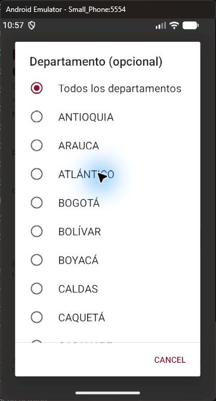
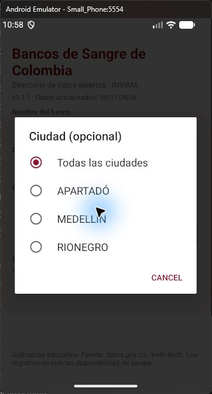
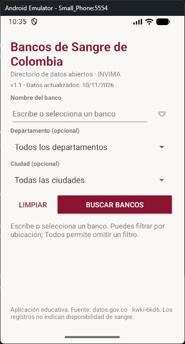
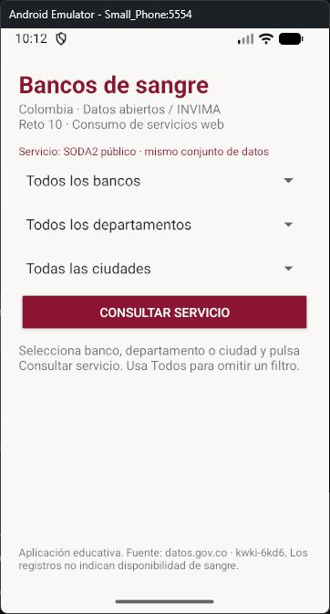
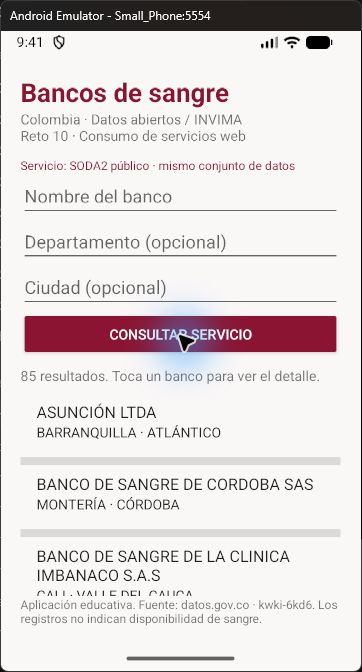
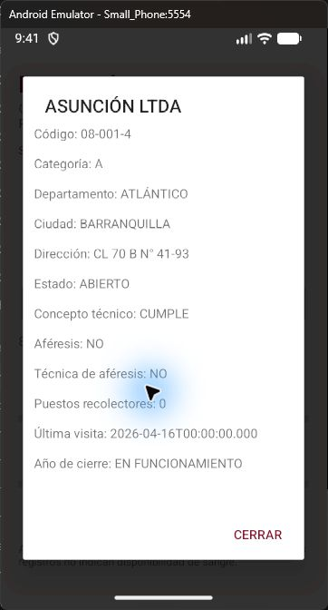

# Validación realizada · 11 de noviembre de 2026

**Actualización 12/11/2026, versión 1.1.2:** el usuario volvió a reportar el fallo de 1.1.1. Las verificaciones históricas siguientes no bastaron para cubrir el recorrido táctil. La corrección actual elimina Spinner y agrega pruebas DOWN/UP, selección y reapertura. Consultar el [informe y resultados actuales](docs/pruebas/REGRESION_SELECTORES.md). Las capturas de versiones anteriores se conservan como antecedentes, no como evidencia de la versión actual.

## Entorno

Android Studio, SDK de compilación 36, Android Gradle Plugin 9.1.0 y Gradle wrapper 9.5.0. Emulador `Small_Phone`, dispositivo ADB `emulator-5554`. Aplicación `co.edu.unal.reto10`, versión debug 1.1.1.

## Resultados comprobados

Corrección 1.1.1: se reprodujo la falta de apertura de los selectores al pulsar su texto y flecha. Se reemplazó esa apertura por un diálogo explícito en `LocationSpinner`. La prueba de regresión ejecuta la acción de clic con hospital escrito y comprueba que ambos diálogos estén visibles y contengan opciones reales; no se limita a cambiar la selección programáticamente.

La lista de Departamento se abrió con clic directo en el emulador reiniciado y permitió seleccionar Antioquia. La prueba instrumentada completa pasó. El emulador requirió un arranque sin instantánea después de un bloqueo de la automatización de accesibilidad; no se borraron sus datos.

Actualización 1.1: nombre editable con sugerencias del catálogo, botón Limpiar, ciudades y bancos según ubicación y fecha oficial de la fuente. Instrumentación correcta para entrada de nombre completo y parcial, limpieza de campos/resultados, ciudades dependientes y fecha visible. La selección táctil de ASUNCIÓN LTDA desde las sugerencias fue verificada visualmente. `rowsUpdatedAt=1794336785`, correspondiente al 10/11/2026 en America/Bogota.

| Verificación | Resultado |
| --- | --- |
| `assembleDebug assembleDebugAndroidTest lintDebug --offline --no-daemon` | Correcto |
| Android Lint | `No issues found.` |
| Instalación de APK y APK de pruebas | `Success` en ambos |
| Runner de instrumentación en Small_Phone | Correcto |
| Consulta real sin filtros mediante SODA2 | 85 registros |
| Consulta real con departamento y ciudad del primer registro | 4 registros, todos correspondientes a los filtros |
| Búsqueda inexistente con apóstrofe | 0 registros; consulta aceptada por el servidor |
| Inicio de actividad y controles de consulta/listado | Correcto |
| Inspección visual del listado | 85 resultados visibles |
| Inspección visual del detalle | Nombre, código, ubicación y demás campos visibles |
| SODA3 sin token | 403 `authentication_required`, comprobado por petición HTTP |
| Sincronización del proyecto en Android Studio | Correcta; módulo app reconocido y Small Phone seleccionado |
| Run desde Android Studio (Shift+F10) | Instalación finalizada correctamente y MainActivity iniciada |

Salida del runner:

```text
OK: apertura visible de Departamento y Ciudad con nombre escrito; limpiar, filtros, fecha y API real. Total=85; filtrados=4; inexistentes=0
```

## Evidencia visual









Las capturas siguientes corresponden a la primera versión y documentan la presentación del listado y del detalle.





## Alcance y límites

La alternativa SODA2 fue autorizada por el solicitante. Se usa el mismo conjunto `kwki-6kd6`, sin datos simulados. SODA3 permanece implementado y se selecciona cuando hay un token local; su ejecución autenticada no ha sido validada porque no se dispone de un token de la cuenta del solicitante.

No se ejecutaron pruebas de pérdida de conectividad, rotación durante una petición ni pruebas en dispositivos físicos. La cantidad de registros puede cambiar con las actualizaciones de la fuente.

Las advertencias de Gradle sobre APIs obsoletas del complemento y las notas de Java sobre compatibilidad no son incidencias de Android Lint ni fallos de compilación.
