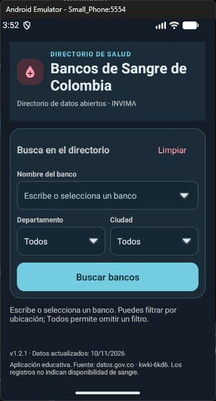
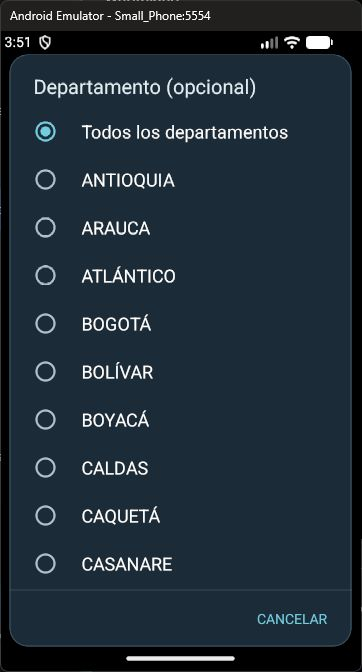
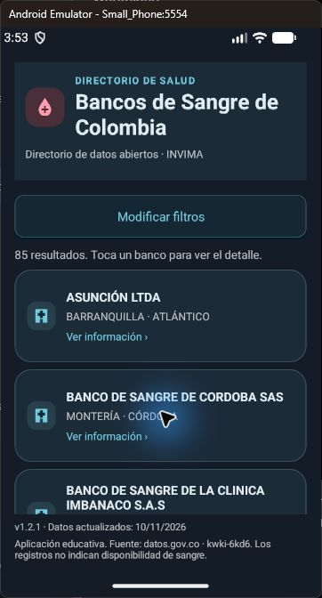
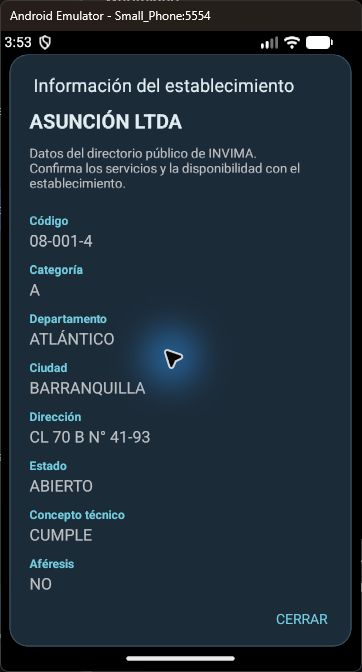

# Corrección de colores · 1.2.1

Fecha: 12/11/2026. Se corrigió la diferencia entre la propuesta aprobada en tema oscuro y la app 1.2.0 publicada en tema claro. La versión instalada es 1.2.1 (versionCode 6).

## Paleta de referencia

Los valores se tomaron de la variante oscura del archivo de propuesta aprobado, no de una aproximación visual:

| Elemento | Color |
| --- | --- |
| Fondo | #101D27 |
| Encabezado, tarjetas y diálogos | #1B2C38 |
| Campos | #142632 |
| Bordes | #3B5261 |
| Texto principal | #E1EDF3 |
| Texto secundario | #AFC1CC |
| Acción principal y enlaces | #74CCE0 |
| Texto sobre acción principal | #102B36 |
| Acción Limpiar y marca de sangre | #FF9DAF |
| Fondo de la marca | #4A2E3B |
| Fondo de iconos | #263F4D |

Se aplica el tema oscuro de forma fija, incluyendo barras del sistema, sugerencias de nombre, flechas, listas de ubicación y detalle. No cambia según el modo claro/oscuro del dispositivo. Se conservan los filtros plegables y las funciones de consulta.

## Verificación ejecutada

- Compilación app y APK instrumentado: BUILD SUCCESSFUL.
- Lint: 0 errores, 1 advertencia sobre versión más reciente de Gradle.
- Regresión instrumentada en Small_Phone API 37.1: PASS.
- Comprobación de colores de fondo, superficies y acción principal contra los valores de la propuesta: PASS.
- Ocho aperturas DOWN/UP de Departamento/Ciudad, selección, reapertura y cancelación: PASS.
- Nombre, sugerencias, Limpiar, filtros dependientes y fecha: PASS.
- Contraer/reabrir filtros y abrir/cerrar detalle: PASS.
- SODA3 real: 85 registros, 4 filtrados, 0 inexistentes.
- Revisión visual del formulario, selector de Departamento, resultados y detalle en el emulador.

[Salida de pruebas](resultado-v1.2.1.txt). No se probaron dispositivos físicos, lector de pantalla ni todas las versiones soportadas de Android.

Durante la revisión manual una consulta devolvió HTTP 400. La app mostró el mensaje de error; al repetir Buscar bancos la misma consulta devolvió 85 registros y se abrió el detalle. Se registra como respuesta puntual del servicio, sin alterar la construcción de consultas en esta corrección de colores.

## Evidencias

