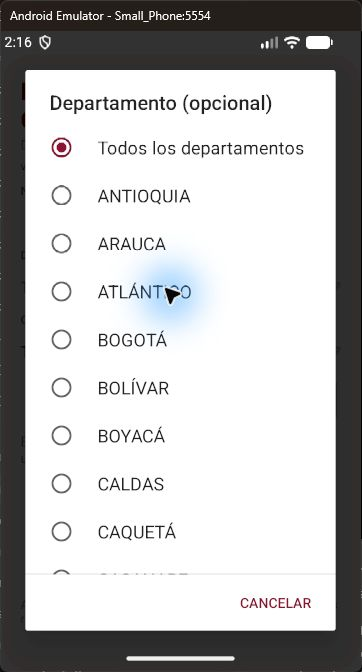
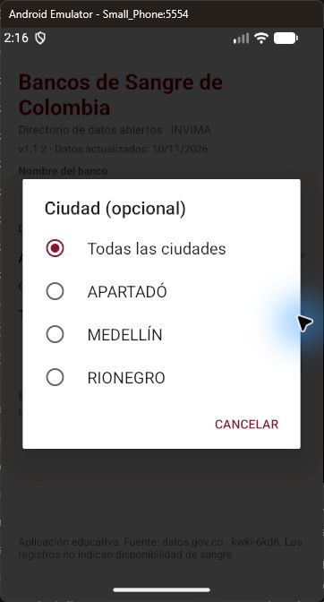

# Regresión de Departamento y Ciudad · versión 1.1.2

Fecha de ejecución: 12/11/2026 (America/Bogota).

## Problema y corrección

El usuario reportó que la versión 1.1.1 seguía sin abrir las listas al pulsar los campos. Esa versión conservaba una subclase de Spinner. La prueba anterior invocaba directamente performClick: comprobaba el diálogo, pero saltaba el recorrido de eventos que usa una pulsación. Por ello no justificaba afirmar que el problema táctil estaba resuelto de manera consistente.

En 1.1.2 se retiraron Spinner y LocationSpinner de estos campos. LocationPicker hereda de Button, tiene una única acción OnClick y abre un AlertDialog con opciones reales, selección actual y Cancelar. Tanto el texto como la flecha forman parte del mismo botón, sin vistas hijas ni interceptores táctiles personalizados. Antes de abrir, se cierran las sugerencias del banco y el teclado. El diálogo se descarta al separar la vista de la ventana.

No se atribuye el problema a una versión concreta de Android: no se ha aislado un defecto interno del framework. La corrección elimina la dependencia del comportamiento táctil anterior.

## Entorno y procedimiento

- SDK de compilación 36, Android Gradle Plugin 9.1.0, Gradle 9.5.0.
- Small_Phone, API 37.1, emulator-5554; consultas reales al conjunto kwki-6kd6 mediante SODA2.
- Java, XML, Instrumentation del SDK; sin dependencias de pruebas externas.

```powershell
.\gradlew.bat assembleDebug assembleDebugAndroidTest lintDebug
adb install -r app/build/outputs/apk/debug/app-debug.apk
adb install -r app/build/outputs/apk/androidTest/debug/app-debug-androidTest.apk
adb shell am instrument -w co.edu.unal.reto10.test/co.edu.unal.reto10.EducationalTestRunner
```

La prueba envía ACTION_DOWN y ACTION_UP a dispatchTouchEvent de cada campo, en su centro y a 12 píxeles del extremo derecho (flecha). No llama directamente a performClick para abrirlos. Comprueba que el diálogo y su lista estén visibles y tengan más de una opción. En la primera apertura elige una opción; en la segunda comprueba que siga marcada y cancela.

Estos eventos se despachan dentro de la app: no equivalen a inyección de entrada a través del sistema completo. La comprobación física con el ratón del emulador se registra por separado.

## Matriz automatizada

| ID | Estado y acción | Resultado esperado |
| --- | --- | --- |
| D01 | Nombre hospital; pulsar centro de Departamento | Lista visible; seleccionar opción actualiza el campo |
| D02 | Pulsar flecha de Departamento después de elegir | Lista visible; conserva la opción marcada; Cancelar cierra |
| C01 | Nombre hospital; pulsar centro de Ciudad | Lista visible con ciudades del departamento; seleccionar actualiza |
| C02 | Pulsar flecha de Ciudad después de elegir | Conserva selección; Cancelar cierra |
| D03 | Limpiar; pulsar centro de Departamento | Abre y permite seleccionar |
| D04 | Reabrir Departamento desde flecha | Conserva selección |
| C03 | Después de Limpiar y elegir departamento; pulsar centro de Ciudad | Abre ciudades disponibles |
| C04 | Reabrir Ciudad desde flecha | Conserva selección |
| F01 | Limpiar campos y resultados | Nombre vacío, ubicaciones en Todos y listado vacío |
| F02 | Consultar por nombre completo y parcial | Resultados correspondientes al texto enviado |
| F03 | Cambiar departamento | Solo ofrece ciudades de ese departamento |
| F04 | Consultar fecha de fuente | Muestra la fecha de rowsUpdatedAt |
| API01 | Consulta sin filtros | Devuelve registros reales |
| API02 | Departamento y ciudad existentes | Todos los registros satisfacen ambos filtros |
| API03 | Nombre inexistente con apóstrofe | Cero resultados, consulta válida |

La salida real de la ejecución se conserva en [resultado-v1.1.2.txt](resultado-v1.1.2.txt). Si contiene FAIL, Process crashed o INSTRUMENTATION_FAILED, el conjunto se considera fallido aunque adb devuelva código de salida 0.

Resultado del conjunto automatizado: **PASS** en D01-D04, C01-C04, F01-F04 y API01-API03. Se obtuvieron 85 registros sin filtros, 4 al filtrar por la ubicación del primer registro y 0 para el nombre inexistente. Compilación de la app y del APK de pruebas correctas. Android Lint: No issues found.

Se corrigió también el aislamiento de los casos: después de probar selección y reapertura se limpian los filtros antes de las consultas por nombre. Una ejecución preliminar detectó correctamente que un nombre ajeno a la ubicación conservada no aparece entre sus sugerencias; ese estado no correspondía a la precondición del caso de búsqueda general.

El emulador integrado presentó pantalla negra al salir de instrumentación. Se reinició Small_Phone sin instantánea y sin borrar datos para realizar las comprobaciones manuales fuera del proceso de pruebas. No se presenta ese reinicio como corrección del código ni como prueba de compatibilidad en dispositivos físicos.

## Comprobación manual posterior al conjunto

En el APK 1.1.2, compilado desde la carpeta de Android Studio e instalado después del reinicio, se pulsó con el ratón el texto de Departamento: abrió la lista y permitió elegir Antioquia. Se pulsó la flecha de Ciudad: abrió Apartadó, Medellín y Rionegro. Se eligió Medellín y el valor se reflejó en el campo.





## Límites de la validación

No se probó en dispositivo físico ni en todas las versiones de Android soportadas. Las pruebas con datos reales requieren conectividad y disponibilidad del servicio. La cantidad de registros y sus fechas pueden cambiar. SODA3 autenticado continúa pendiente de un token local válido.
