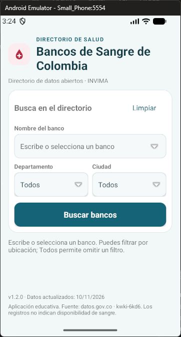
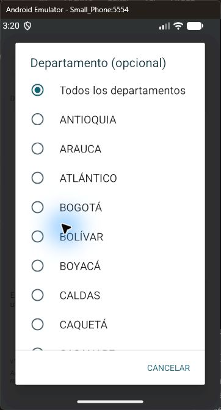
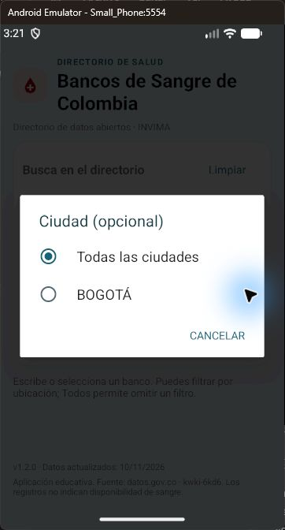
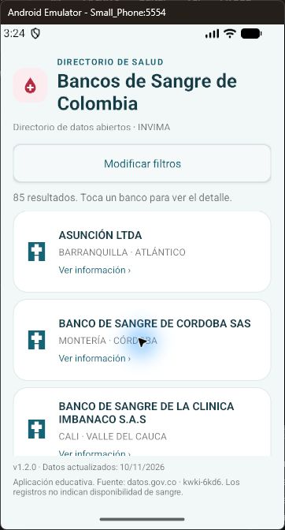
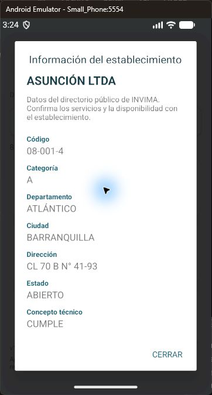

# Validación del diseño médico · 1.2.0

Fecha: 12/11/2026. Versión: 1.2.0 (versionCode 5). Diseño mostrado y aprobado por el solicitante antes de implementar e instalar la nueva versión.

## Entorno y alcance

Android Studio, Small_Phone (API 37.1), Java/XML, SDK de compilación 36. Compilación final desde la carpeta de Android Studio con el token local existente; servicio SODA3 real. No se incorpora el token a Git ni se publica el APK.

## Matriz ejecutada

| Caso | Método | Resultado |
| --- | --- | --- |
| Compilar app y APK instrumentado | assembleDebug assembleDebugAndroidTest | BUILD SUCCESSFUL |
| Análisis estático | lintDebug | 0 errores, 1 advertencia de actualización de Gradle |
| Abrir Departamento y Ciudad por centro/flecha, con texto y tras Limpiar | 8 secuencias DOWN/UP dentro de la app | PASS |
| Seleccionar, reabrir, conservar valor y cancelar | Instrumentado | PASS |
| Sugerencias, nombre completo/parcial, Limpiar y ciudades dependientes | Instrumentado + API | PASS |
| Fecha de actualización de fuente visible | Instrumentado | PASS |
| Versión instalada 1.2.0 | Instrumentado | PASS |
| Tarjeta contiene nombre y ubicación | Instrumentado | PASS |
| Contraer y reabrir filtros | Instrumentado | PASS |
| Abrir y cerrar detalle | Instrumentado | PASS |
| Consulta sin filtros / con ubicación / inexistente con apóstrofe | SODA3 real | 85 / 4 / 0 registros |
| Centro de Departamento y flecha de Ciudad, elegir Bogotá y consultar | Ratón del emulador | Listas abiertas y selección reflejada |
| Búsqueda sin filtros, tarjetas y apertura/cierre de ficha | Ratón del emulador | 85 resultados y detalle de ASUNCIÓN LTDA visibles |

[Salida instrumentada final](resultado-v1.2.0.txt).

La primera ejecución de la prueba nueva comprobaba el cierre del diálogo antes de que Android terminara su evento. Se corrigió la sincronización usando waitForIdleSync antes de la aserción; la ejecución final pasó. No se ocultó un error de la app.

En la revisión visual se compactó «Todos» en los campos de ubicación y se añadió el plegado de filtros para liberar espacio para las tarjetas en Small_Phone. Se corrigieron las advertencias de fondo duplicado, etiqueta de accesibilidad y simetría de padding. Permanece únicamente la advertencia de versión disponible de Gradle; no se cambió la cadena de compilación.

## Capturas reales

Las capturas de selectores se tomaron durante la revisión de 1.2.0; los ajustes finales de simetría y el plegado de resultados no modifican su comportamiento ni presentación. Inicio, resultados y detalle corresponden a la instalación final validada.

## Repetir

Seguir los comandos del README: compilar app y pruebas, instalar ambos APK y ejecutar EducationalTestRunner. La prueba requiere conexión y un catálogo accesible. Revisar el contenido de la salida: adb puede devolver código 0 aunque el runner informe FAIL.

## Límites

No se verificaron dispositivo físico, lector de pantalla, escalas de fuente grandes, orientación horizontal, pérdida de red durante una petición ni todas las API soportadas. Las cantidades y la fecha de fuente pueden cambiar. Los datos del directorio no indican disponibilidad de sangre. El diseño es académico y no representa una aplicación oficial de INVIMA o de la Universidad.
